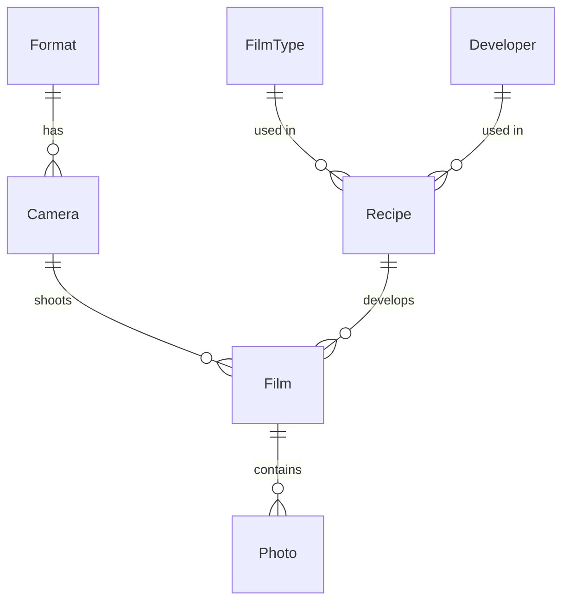

# Data model



All foreign keys are non-nullable `int`s, so EF Core configures them as **required with cascade delete**.

## Entities

| Entity | Fields | `ToString()` |
|--------|--------|--------------|
| **Format** | `Id`, `Name` | `Name` |
| **Camera** | `Id`, `Name`, `FormatId` | `Name` |
| **FilmType** | `Id`, `Name`, `ISO` (decimal), `Color_Is_Possible` | `"HP5 400"` (ISO shown as an integer when ≥ 1) |
| **Developer** | `Id`, `Name` | `Name` |
| **Recipe** | `Id`, `FilmTypeId`, `DeveloperId`, `EI` (decimal), `Min`, `Sec`, `Color` | `"HP5 400 in ID-11 as 800 EI"` (also `To_StringForFT` and `To_StringForDev`) |
| **Film** | `Id`, `RecipeId`, `CameraId`, `Date`, `FolderName` | `"22-08-06_bw_Zenit"` (`_col_` / `_bw_`, or `_X3_` when the recipe isn't loaded) |
| **Photo** | `Id`, `Name`, `Pic` (file name), `FilmId`, `Is_Liked`, `Page`, `Line`, `Place_In_Line` | — |

Every entity also exposes a `To_String` property. It exists so that `SelectList` and `DisplayFor` can show the `ToString()` text.

## Album layout

`Photo.Page`, `Photo.Line` and `Photo.Place_In_Line` place each photo on a virtual album page:

```
Page 3
 ├─ Line 0: [p.Place_In_Line=0] [1] [2] ...
 ├─ Line 1: ...
```

Pages are global across films, so one film can span several pages and one page can hold several films. Bulk upload puts every file on the same page and line it was given, with `Place_In_Line = 0`.

## Cascade deletes (be careful)

Deleting a parent removes **everything below it**:

- Format → Cameras → Films → Photos
- FilmType or Developer → Recipes → Films → Photos
- Film → Photos

The Delete confirmation page shows the counts, but **the files on disk (originals and miniatures) are never removed**.

## Notes

- `Photo.Date` is commented out. Dates live only on `Film`.
- Navigation properties are nullable (`Format?`, `Film?` and so on), which causes most of the nullable warnings in the build.
- There is no unique constraint anywhere. For example, the same file name can be added twice to one film.
